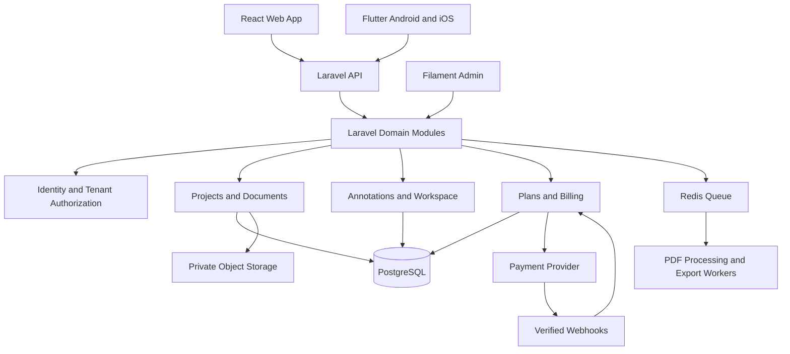

# 2. Architecture and Technology Stack

## 2.1 Recommended stack

| Layer | Recommendation | Notes |
|---|---|---|
| Backend | Laravel + PHP | REST API, domain logic, authorization, billing |
| Database | PostgreSQL | Relational data, JSONB where appropriate, full-text search |
| Web | React + TypeScript + Vite | Main application |
| UI | Tailwind CSS + shadcn/ui | Accessible, reusable components |
| PDF | PDF.js | Browser PDF rendering and text layer |
| Canvas | Konva.js or tldraw | Evaluate accessibility, persistence, licensing, and interaction fit |
| Admin | Filament | Admin resources and actions inside Laravel |
| Mobile | Flutter | Shared Android/iOS codebase |
| Authentication | Laravel Sanctum or suitable session/token setup | Select cookie/session vs token model based on clients |
| Queue/cache | Redis + Laravel Queues | Processing and exports |
| File storage | S3-compatible private storage or Cloudflare R2 | Private buckets and short-lived signed URLs |
| Search | PostgreSQL full-text initially | Evaluate dedicated search only when needed |
| Payments | Razorpay for suitable India use cases; Stripe where supported | Verify country, product, and store requirements |
| Testing | Pest/PHPUnit, React Testing Library, Playwright, Flutter tests | Unit through end-to-end |
| Deployment | Docker, CI/CD, managed database and object storage | Choose provider based on budget and operational needs |

## 2.2 Logical architecture



## 2.3 Architectural approach

Begin with a modular monolith. Avoid microservices until scaling, independent deployment, or team boundaries justify them.

Suggested domains:
- Identity and access
- Organizations and memberships
- Projects and documents
- PDF processing and search
- Annotations and excerpts
- Workspace and links
- Exports
- Plans, subscriptions, and usage
- Administration and audit
- Operations and monitoring

## 2.4 File processing lifecycle

1. Authorize upload and check plan quota.
2. Validate file size, allowed extension, MIME type, and PDF signature.
3. Store file in private object storage using a non-guessable key.
4. Create a document record with `processing` status.
5. Queue metadata/text extraction and thumbnail generation.
6. Update status to `ready` or a safe, inspectable failure state.
7. Record usage according to a defined accounting policy.
8. Provide access only through an authorized API or short-lived signed URL.

Consider malware scanning, decompression/resource limits, parser timeouts, and isolation for processing untrusted files.

## 2.5 Realtime collaboration

Defer realtime collaboration until the single-user workspace is reliable. Later, evaluate Yjs with a compatible collaboration server, authorization integration, persistence, reconnection behavior, and conflict tests. Do not assume a Laravel API alone provides Yjs collaboration.

## 2.6 Security boundaries

- Authenticate every private API request.
- Authorize the specific resource and tenant for every operation.
- Keep storage private.
- Validate all input and limit payload sizes.
- Verify payment webhook signatures.
- Apply idempotency to webhooks and sensitive jobs.
- Keep secrets out of source control.
- Log security events without logging passwords, tokens, or document contents.
- Use least-privilege database and storage credentials.

## 2.7 Suggested repositories

```text
research-saas/
  backend/        Laravel API and Filament
  web/            React + TypeScript
  mobile/         Flutter
  infra/          Docker, CI/CD, deployment manifests
  docs/           Product, architecture, testing, runbooks
```

A monorepo is also possible; select one repository strategy and document ownership and release versioning.
