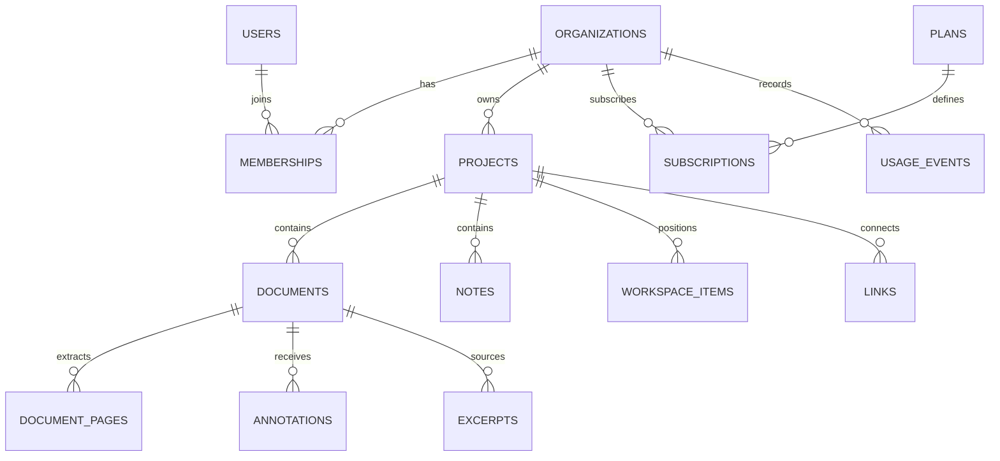

# 3. Database Design

## 3.1 Core tables

| Table | Purpose | Important fields |
|---|---|---|
| users | User accounts | id, name, email, password, email_verified_at |
| organizations | SaaS tenants | id, name, status |
| memberships | User-to-tenant roles | organization_id, user_id, role |
| projects | Research projects | organization_id, created_by, name |
| project_members | Optional project access | project_id, user_id, role |
| documents | PDF metadata | organization_id, project_id, storage_key, checksum, status, page_count |
| document_pages | Extracted page text | document_id, page_number, text |
| annotations | Highlights/comments/ink | document_id, page_number, type, payload |
| excerpts | Source selections | document_id, page_number, text, source_rects |
| notes | Research notes | project_id, content, created_by |
| workspace_items | Canvas layout | project_id, item_type, target_id, x, y, width, height |
| links | Connections | project_id, source_type/id, target_type/id |
| plans | Plan definitions | code, limits, features, active |
| subscriptions | Provider-linked status | organization_id, plan_id, provider, provider_subscription_id, status |
| payment_events | Webhook idempotency | provider, provider_event_id, status, processed_at |
| usage_events | Usage ledger | organization_id, event_type, quantity, idempotency_key |
| exports | Export lifecycle | project_id, requested_by, status, storage_key, expires_at |
| audit_logs | Security/admin history | actor_id, action, target_type/id, metadata |
| feature_flags | Feature rollout | key, enabled, rules |

Laravel's standard tables may also include password reset tokens, sessions, personal access tokens, jobs, failed jobs, cache, and cache locks.

## 3.2 Relationships



## 3.3 Data design rules

- Use UUIDs for externally exposed IDs if appropriate for the application.
- Use foreign keys and explicit deletion behavior.
- Add indexes for tenant ID, project ID, document ID, page number, status, and common query paths.
- Add uniqueness constraints for normalized account email and provider webhook event identifiers.
- Keep source-page and coordinate information with excerpts and annotations.
- Define whether page numbering is one-based in APIs and use it consistently.
- Define coordinate units and coordinate origin. Store PDF-space rectangles or normalized rectangles so zoom changes do not break annotation alignment.
- Keep the original uploaded file immutable; record a checksum.
- Use a typed link schema or validated polymorphic references. Avoid accepting arbitrary model types from clients.
- Define soft deletion, permanent deletion, retention, and backup expiry explicitly.

## 3.4 Tenant isolation

Every organization-owned resource must be checked against the active organization membership and role. Apply authorization in policies/services and tenant-aware queries. PostgreSQL Row-Level Security may provide defense in depth, but only when policies and database roles are configured and tested correctly.

## 3.5 Example excerpt record

```json
{
  "id": "uuid",
  "organization_id": "uuid",
  "project_id": "uuid",
  "document_id": "uuid",
  "page_number": 12,
  "text": "Selected text from the source PDF",
  "source_rects": [
    {"x": 0.12, "y": 0.28, "width": 0.54, "height": 0.04}
  ]
}
```

The rectangle example uses normalized page coordinates; implementation must define and consistently apply the coordinate system.

## 3.6 Usage and billing integrity

- Define the quota unit for every limit.
- Avoid counting the same upload or webhook twice after retries.
- Record usage events with an idempotency key.
- Define how deleted files affect usage and when usage is recalculated.
- Do not grant paid entitlements based solely on a client redirect.
